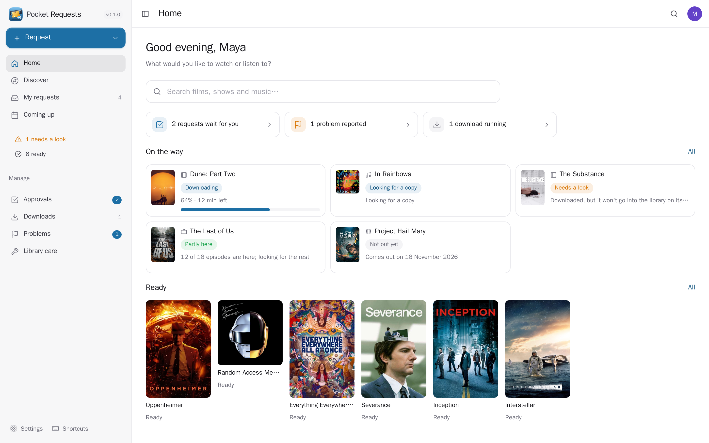
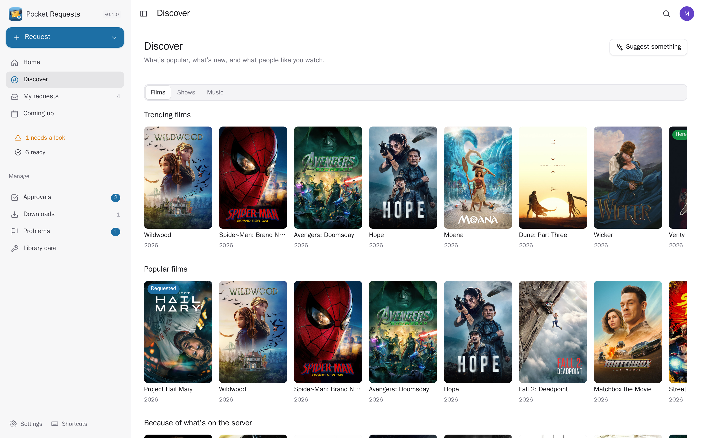
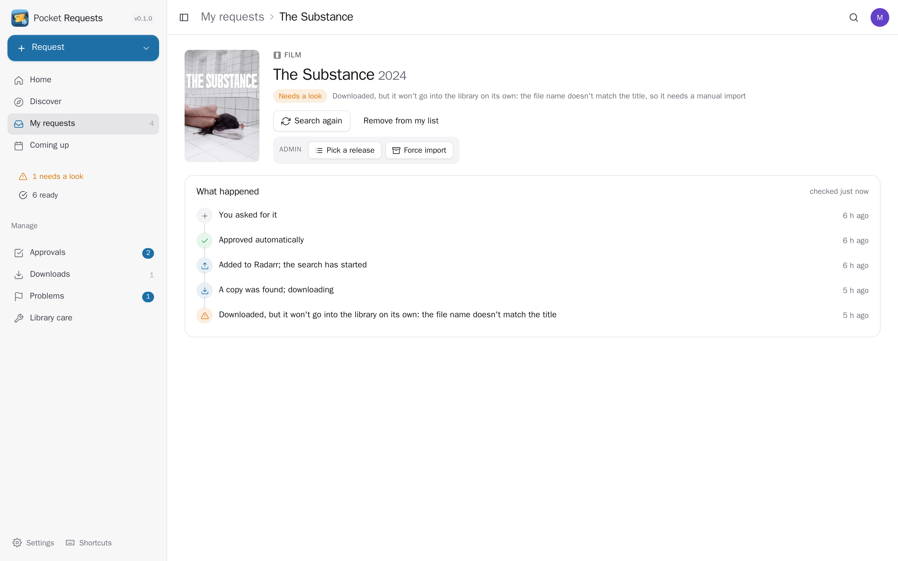
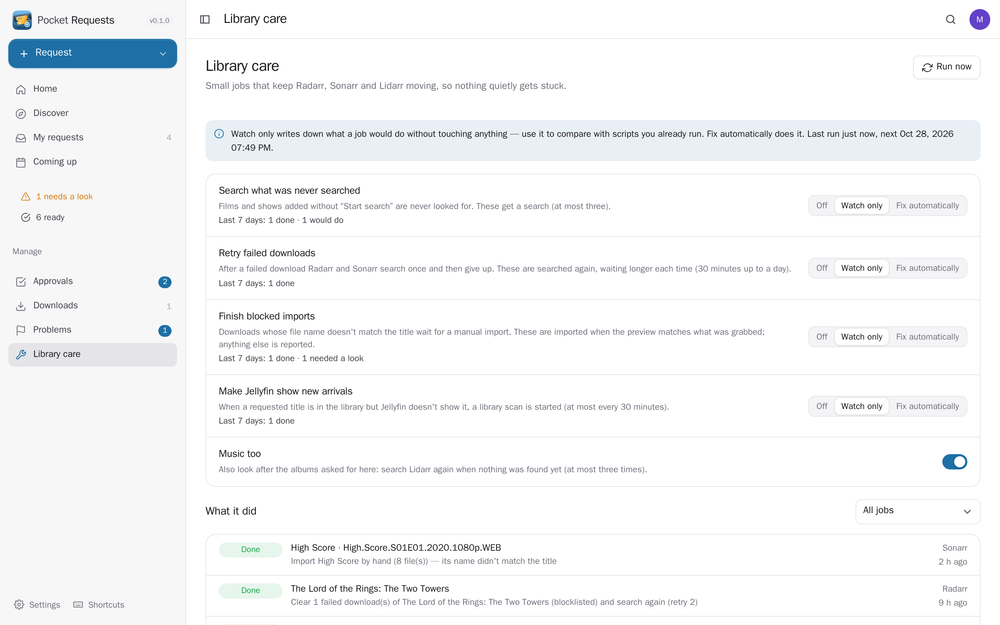
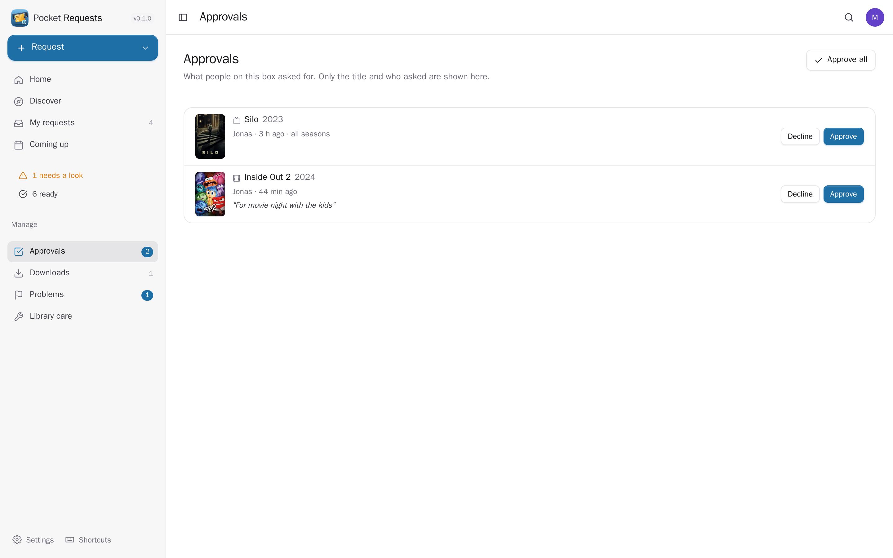
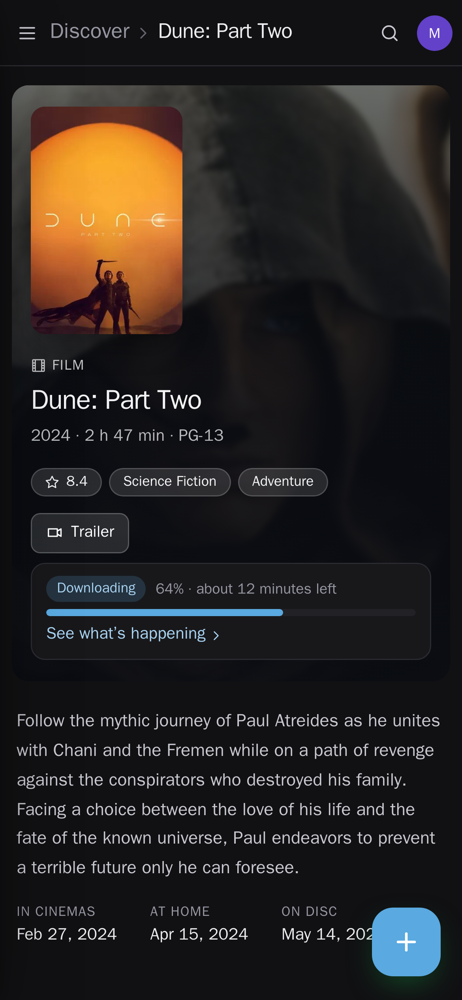
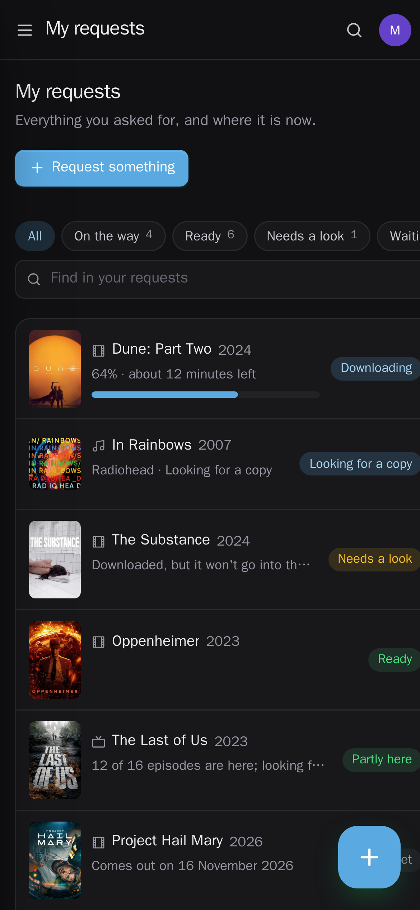

<p align="center"></p>
<h1 align="center">Pocket Requests</h1>
<p align="center">Ask for a film, a show or an album, and follow it until it is ready to watch or listen to. Search and discover what's trending, popular or airing this week, ask for a whole show or only some seasons, and see every request's story in plain words — looking for a copy, downloading (with time left), moving into the library, ready, or stuck and why. Members' requests wait for an admin to approve them (or go straight through), with weekly limits if you want them. Admins pick a release by hand, finish a blocked import, replace a bad download and sort out reported problems, and library care keeps Radarr, Sonarr and Lidarr moving: it searches what was added without a search, retries failed downloads and finishes imports the services won't do on their own. Brings Jellyseerr's requests over. Radarr, Sonarr and Lidarr stay the engines.<br>One Go binary, one SQLite file, one volume. Part of the Pocket apps; works on its own too.</p>
<p align="center">
  <a href="https://github.com/abjelosevic88/pocket-homelab-requests/actions"></a>
  <a href="https://github.com/abjelosevic88/pocket-homelab-requests/pkgs/container/pocket-homelab-requests"></a>
  <a href="LICENSE"></a>
</p>

---

<p align="center"></p>

<table>
  <tr>
    <td width="50%"></td>
    <td width="50%"></td>
  </tr>
  <tr>
    <td align="center"><sub>Discover what's trending, popular, airing this week or new from artists you already have.</sub></td>
    <td align="center"><sub>Every request tells its story in plain words; admins can pick a release or finish an import.</sub></td>
  </tr>
  <tr>
    <td width="50%"></td>
    <td width="50%"></td>
  </tr>
  <tr>
    <td align="center"><sub>Library care: search the never-searched, retry failed downloads, finish blocked imports, nudge Jellyfin.</sub></td>
    <td align="center"><sub>Members' requests wait for you — approve, decline with a reason, or let them through.</sub></td>
  </tr>
  <tr>
    <td width="50%"></td>
    <td width="50%"></td>
  </tr>
</table>

## What it does

- **Find it**: one search over films (Radarr/TMDb), shows (Sonarr/TheTVDB) and albums (Lidarr/MusicBrainz). Discover trending, popular and "because of what's on the server" films, shows with new episodes this week (TVmaze, no key), trending and best-rated shows (with a TMDb key), new albums from artists you have. "Suggest something": describe a mood, Pocket AI picks, the services check they're real.
- **Ask for it**: films, whole shows or chosen seasons, albums (only that album, not the whole discography). A note for the admin. Already here, already asked for by someone else, already yours — each is shown before you ask.
- **Follow it**: waiting for approval → sent → not out yet (with the date) → looking for a copy → downloading (progress, time left) → moving into the library → ready, with a link to watch it in Pocket Watch or Jellyfin. "Partly here" counts episodes and tracks; "needs a look" says why in words, not in log lines. A timeline on every request. Coming up: the next episodes and release days of what you asked for.
- **Approvals and limits**: admins' requests go straight through; members' per the box (approve automatically, or I decide), per person, with weekly limits per kind. Requests made from other Pocket apps through Pocket Core follow the same rules.
- **Fix it (admins)**: pick a release by hand from the indexers' results, run a manual import after a preview that shows where each file would go, throw a bad download away (blocklisted) and search again, answer reported problems ("wrong film", "no sound", "subtitles late"). Downloads: all three queues in one list, warnings highlighted, SABnzbd's speed, what's left and free space with pause / resume. Services: how each is reached, their own warnings, indexers Prowlarr has paused.
- **Soulseek**: when Soularr fetches Lidarr's albums from Soulseek, the request shows the slskd download ("Downloading from Soulseek — about 6 minutes left") and the Downloads page lists it; an album Soularr gave up on (its import blacklist) shows as "needs a look", and an admin can let Soulseek try again.
- **Clean up (admins)**: remove a film, a show, some seasons of a show, or an album from the server — with or without its files, optionally kept off import lists. The dialog shows the size and warns when Radarr/Sonarr have no recycle bin; everyone's request for it says "Removed from the server".
- **Library care**: for the whole library, not only requests — searches what was added without a search, retries failed downloads with a growing back-off, finishes "matched by ID" / "title mismatch" imports when the preview agrees with what was grabbed, starts a Jellyfin scan when something arrived but doesn't show. Each job Off, Watch only (reports what it would do) or Fix automatically, with a log.
- **A Jellyseerr stand-in**: apps made for Jellyseerr (Pocket Watch, Pocket Core, the Homepage widget, Uptime Kuma, phone apps) talk to Pocket Requests with Jellyseerr's API — requests, users, issues, search, discover, film and show pages, Jellyfin sign-in. Keep Jellyseerr's API key and old address and nothing has to be reconfigured.
- **From Jellyseerr**: bring every request over for the person with the same email, status and dates kept; run it again any time, nothing doubles.
- **Notifications**: approved, ready, needs a look — and for admins, new requests, problems and library care — through Apprise, ntfy or a webhook.
- **Everyone their own**: each person sees only their own requests, timelines and problems. Two people asking for the same film share the download, not their lists. Admins see members' requests only while deciding on them.

## Run it

```sh
docker run -d --name pocket-requests -p 8080:8080 -v ./data:/data \
  -e BASE_URL=https://requests.example.com -e SECURE_COOKIES=true \
  -e RADARR_URL=http://radarr:7878 -e RADARR_API_KEY=… \
  -e SONARR_URL=http://sonarr:8989 -e SONARR_API_KEY=… \
  ghcr.io/abjelosevic88/pocket-homelab-requests:latest
```

or `docker compose up -d` with [docker-compose.yml](docker-compose.yml). Open it, create the first account and ask for something. Services can also be set up later under Settings → Services. All options: [docs/configuration.md](docs/configuration.md). API: [docs/api.md](docs/api.md).

## With Pocket Core

Set `CORE_URL` and `CORE_REGISTRATION_KEY` and Requests joins the box: people sign in with Pocket Core, and the box's Radarr, Sonarr, Lidarr, Prowlarr, Jellyfin, Jellyseerr and TMDb logins come from Core — nothing to paste. Other Pocket apps can read your requests and what releases next (`requests:read`: Pocket Calendar, Pocket Day, Pocket Watch) or ask for titles on your behalf (`requests:write`: a "Request" button in Pocket Watch or Pocket Music); "Suggest something" uses Pocket AI. Events on the bus: `requests.created`, `requests.approved`, `requests.declined`, `requests.available`, `requests.attention`, `requests.problem_reported`. Without Core every service is connected directly; the Core-only choices stay visible, greyed out.

## Develop

```sh
make dev     # API on :8080 with demo data + Vite on :5173
make test    # go vet, go test, tsc
make         # web + binary
```

MIT licensed.
